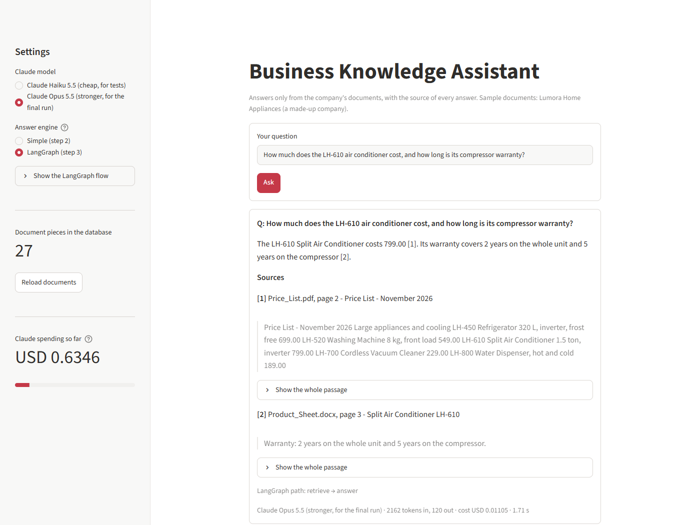
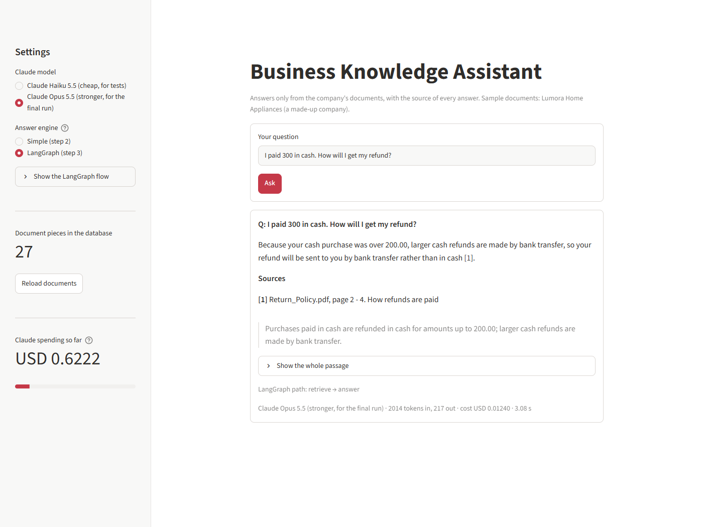
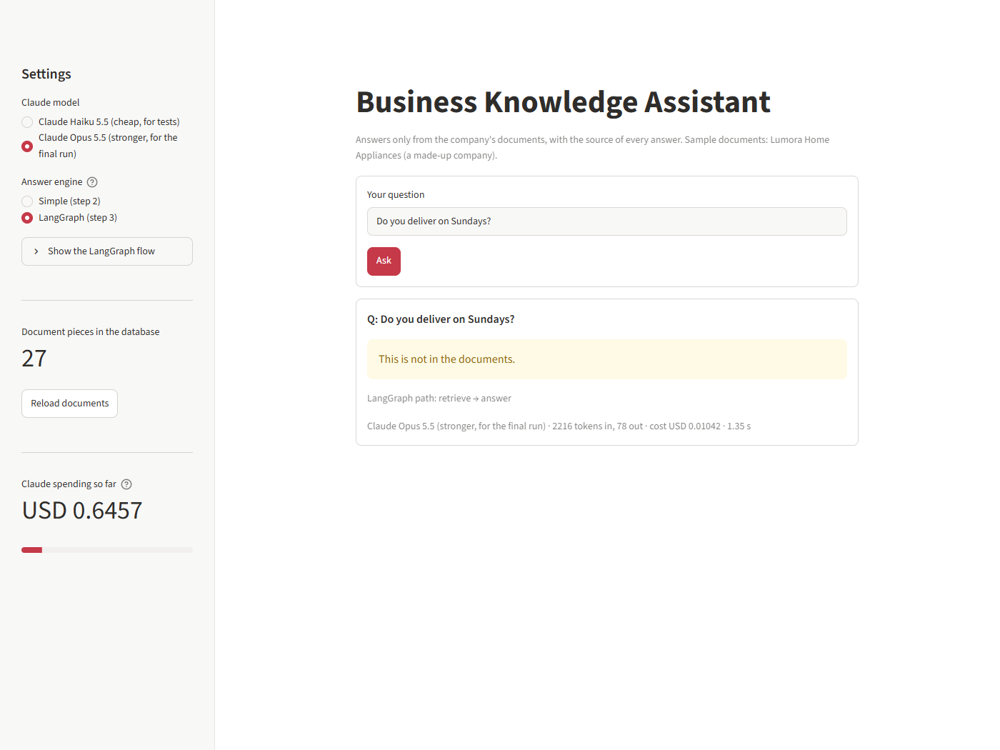
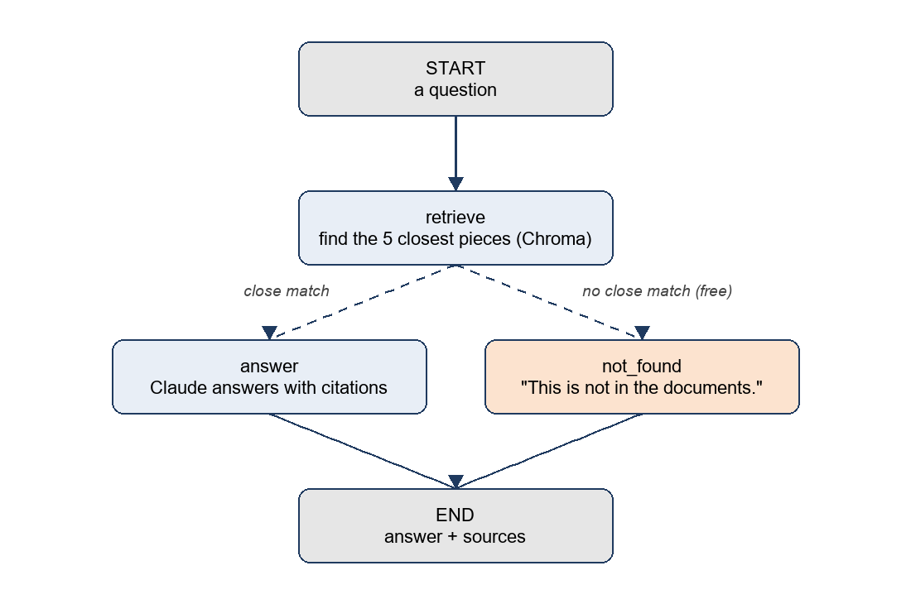

# Business Knowledge Assistant 📚🤖

**Ask questions about a company's own documents and get answers with the source of every fact.** A company puts its PDF and Word files in a folder; an assistant built on **Anthropic Claude** answers only from those files, shows the file and page behind each answer, and says *"This is not in the documents"* instead of guessing.

Designed and built by **Iftikhar Ahmed** with Claude Code (2026).

> This is a showcase. The source code is private. A live demo or code walkthrough is available on request.

   
  <em>One question, two documents: the price comes from the price list (page 2), the warranty from the product sheet (page 3). Each source shows the exact passage Claude used.</em>

---

## What it does

1. The company's documents (PDF and Word) are read and cut into small pieces, one topic each, keeping the file name, page and heading of every piece.
2. Each piece is stored in a **vector database**, so the assistant can find passages that *mean* the same as a question, not only ones with the same words.
3. A question comes in. The 5 closest passages are found in a fraction of a second, on the company's own computer.
4. **Claude** writes a short answer from those passages only. Claude's built-in **citations** mark the exact sentence behind each fact, shown as [1], [2].
5. If the documents do not contain the answer, the assistant says so. It never fills the gap from general knowledge.

**Safety by design:** answers only from the company's documents; every fact traceable to a file and page; a clear "not in the documents" instead of a guess; the documents and the search stay on the company's computer; a spending limit stops all AI calls at a set amount.

## Results (20-question test)

| What | Result |
|---|---|
| Questions the documents can answer | **14 of 15 correct**, 1 partly correct (right facts, one source pointed to the wrong page) |
| Questions the documents cannot answer (traps: a product that does not exist, a price in euros, Sunday delivery, the store manager's name) | **5 of 5** correctly answered "not in the documents" |
| Made-up facts | **None** — every answer was read and checked by hand |
| Time per question | about **2 seconds** |
| Cost per question | about **1 US cent** (Claude Opus 5.5) · about 0.03 US cents with the smaller Claude Haiku 5.5 |

**Tested honestly:** the first test run missed one answer. The cause was found (one page with four topics had been stored as one piece, so the search could not find the extended-warranty rule), the reading step was improved to cut pieces at headings, and every earlier test was run again before the final score.

## Screens (made-up company "Lumora Home Appliances")

   
  <em>"I paid 300 in cash. How will I get my refund?" — the assistant applies the return policy (cash refunds only up to 200.00) and shows the passage it used.</em>

   
  <em>"Do you deliver on Sundays?" — the documents do not say, so the assistant does not guess.</em>

   
  <em>The answer flow as a LangGraph graph: find the closest passages, then either answer with citations or — when nothing is close — reply "not in the documents" without calling the AI at all.</em>

   
  <em>The same document search offered as an <b>MCP server</b>: Claude Code (or Claude Desktop) calls the search tool by itself and answers with file and page. A real test run.</em>

## How it fits together

1. **Documents**: PDF and Word files in one folder.
2. **Reading step**: text page by page, cut into one-topic pieces with their headings; headers and footers removed.
3. **Vector database (Chroma)** with a free embedding model that runs on the company's own computer.
4. **Answer flow (LangGraph)**: search → close enough? → Claude answers with citations, or "not in the documents".
5. **Web page**: question box, answer, sources with the quoted passage, cost of each question.
6. **MCP server**: the same search as a tool for Claude Code and Claude Desktop.

## Main parts of the system

| Part | What it does |
|---|---|
| Document reader | Reads PDF and Word, removes headers and footers, keeps file, page and heading |
| Vector database | Stores the pieces and finds the closest ones to a question |
| Answer engine | Claude with built-in citations; two versions: plain Python and LangGraph |
| Web page | Ask questions, see answers, sources and cost |
| MCP server | One read-only search tool for Claude Code and Claude Desktop |
| Tests | 48 automatic checks across all steps, plus the 20-question scored test |

## Built with

Anthropic Claude (Opus 5.5, Haiku 5.5) · Claude citations · Claude Code · Python · LangChain · LangGraph · Chroma vector database · all-MiniLM-L6-v2 embeddings (local) · Model Context Protocol (MCP) · Streamlit

## Status

Working prototype, tested with made-up company documents, running on a local computer. Next: more document types, larger document sets, and a hosted version with a login for a client.

---

**Contact:** iftikhar.ahmed.job1@gmail.com · [GitHub profile](https://github.com/iftikhar-ahmed-ai)

© 2026 Iftikhar Ahmed. All rights reserved.
