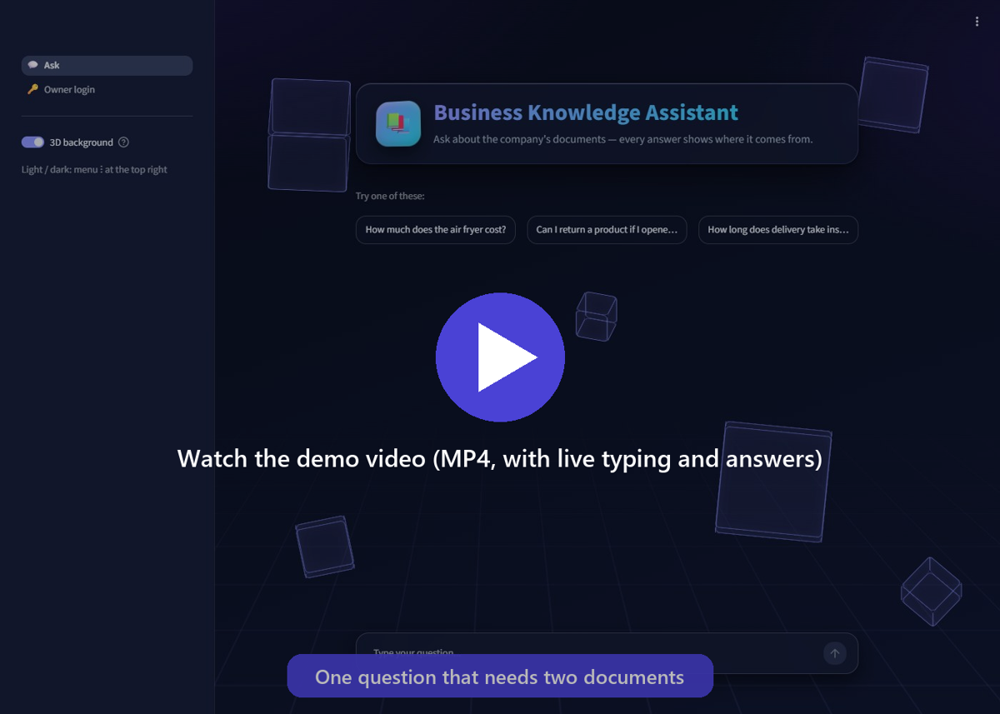
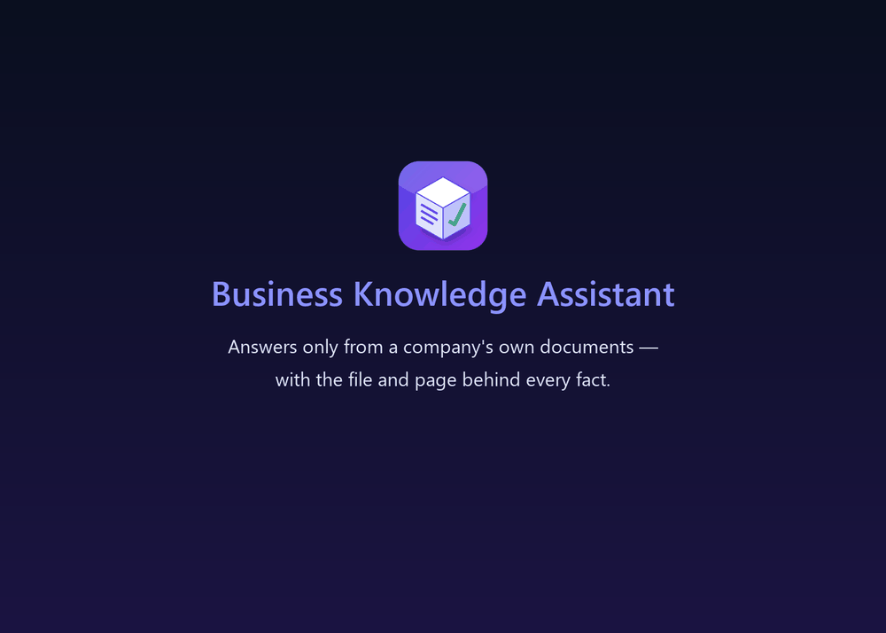
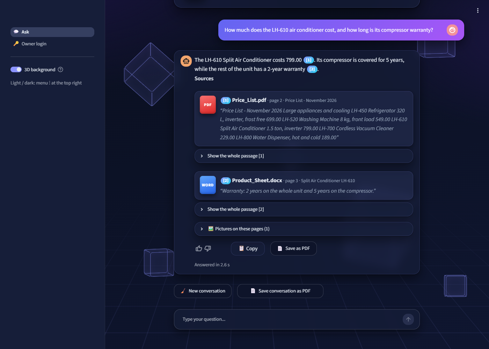
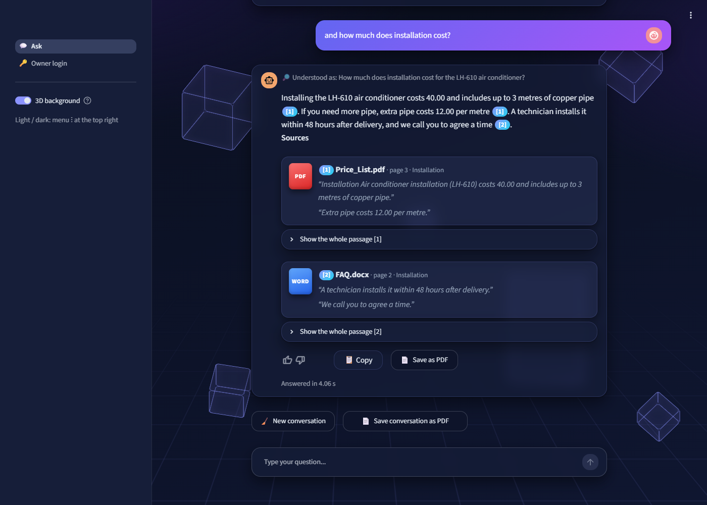
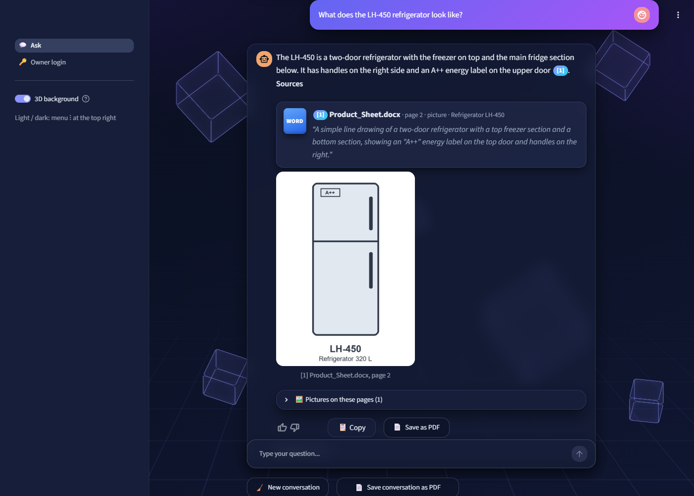
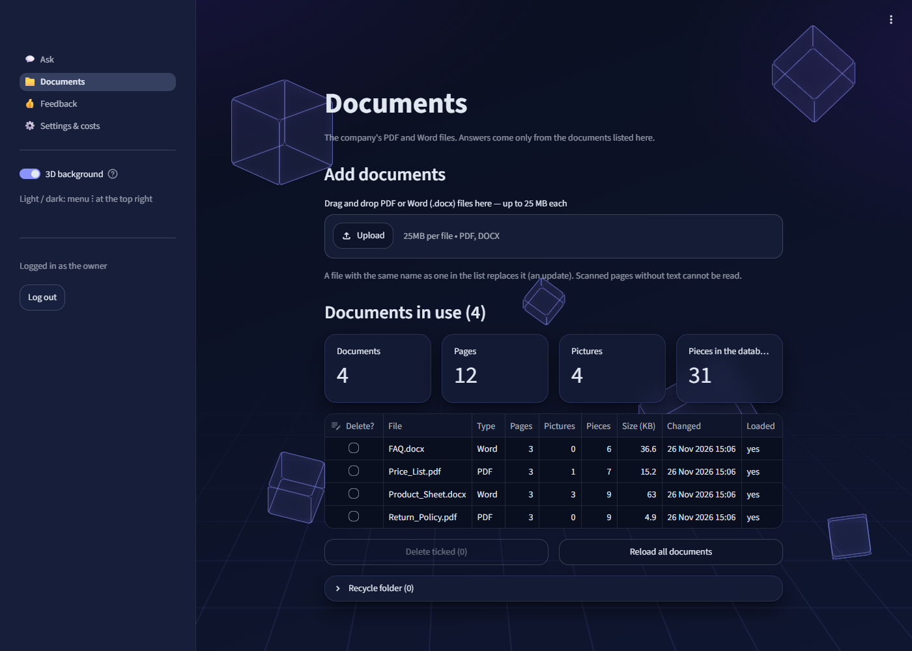
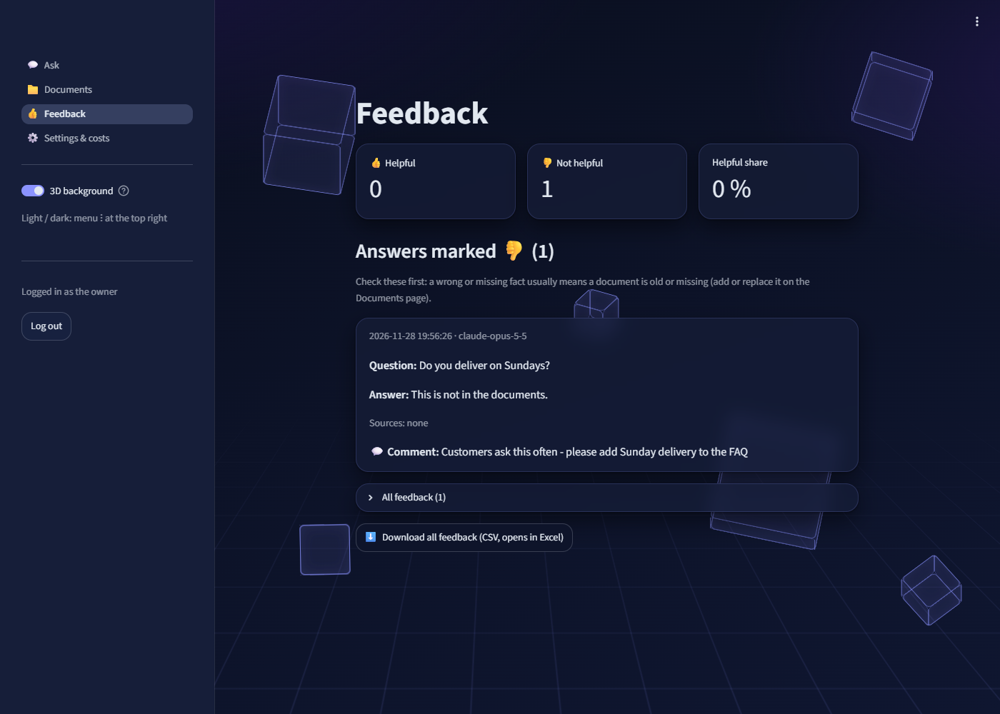
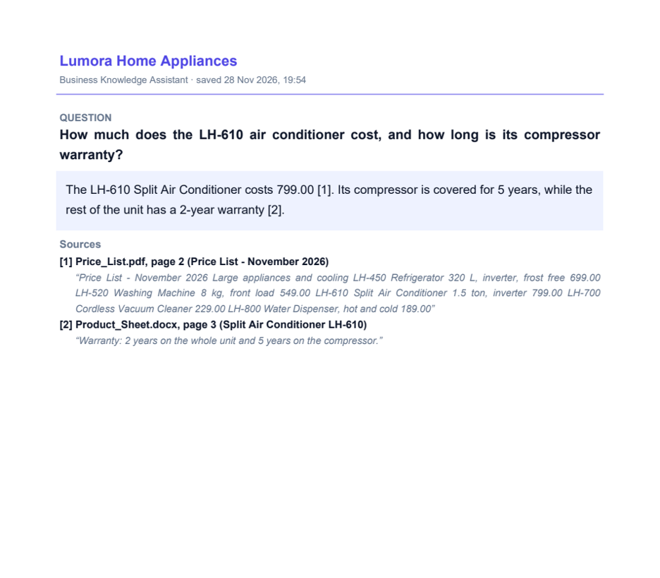
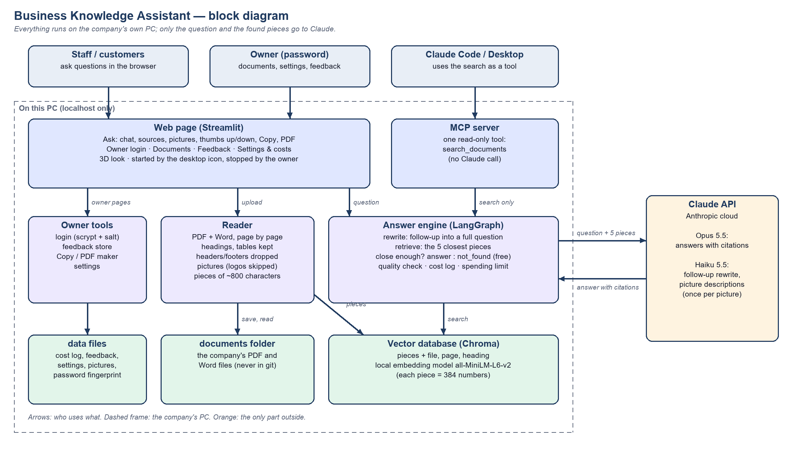
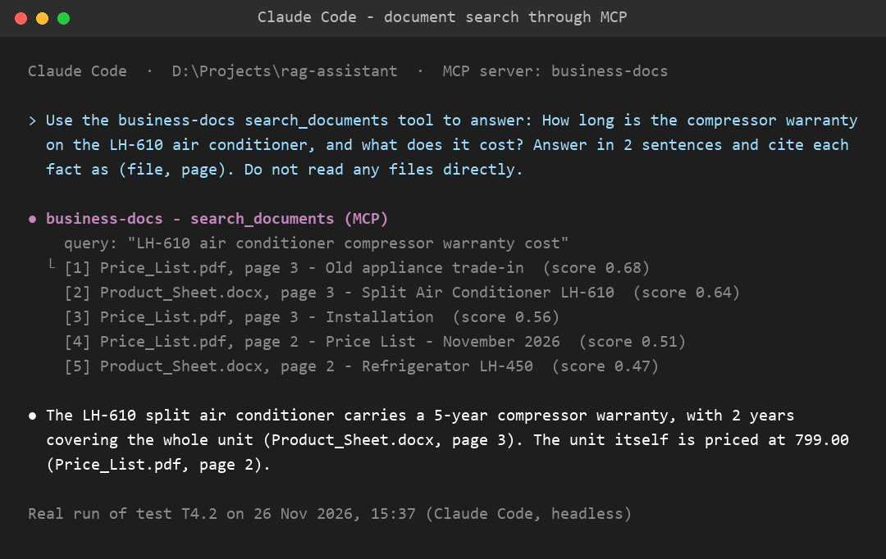

# RAG Business Knowledge Assistant 📚🤖

**Ask questions about a company's own documents and get answers with the source of every fact.** A company puts its PDF and Word files in one place; an assistant built on **Anthropic Claude** answers only from those files, shows the file, page and exact sentence behind each answer, and says *"This is not in the documents"* instead of guessing.

Designed and built by **Iftikhar Ahmed** with Claude Code (2026) · **Version 2**

> This is a showcase. The source code is private. A live demo or code walkthrough is available on request.

   
  <em>▶ <a href="images/demo.mp4"><b>Watch the demo video</b></a> (1 min 49 s, MP4) — a real recording of the program: live typing, answers with sources, Copy and PDF, a follow-up, a picture from the documents, "not in the documents", feedback, light and dark, and the owner's pages. Made-up company "Lumora Home Appliances".</em>

   
  <em>The same tour as a short animation (45 seconds).</em>

---

## What it does

1. The owner adds the company's PDF and Word files on a password-protected page. They are read page by page and cut into small one-topic pieces, keeping the file, page and heading of each piece. **Pictures inside the documents** (product photos, drawings) are taken out and described once, so they can be found too.
2. Each piece is stored in a **vector database**, so the assistant finds passages that *mean* the same as a question, not only ones with the same words.
3. Staff ask in a chat. A **follow-up** such as *"and how much is it?"* is first turned into a full question using the conversation.
4. The 5 closest passages are found on the company's own computer, and **Claude** writes a short answer from those passages only. Claude's built-in **citations** mark the exact sentence behind each fact, shown as [1], [2].
5. If the documents do not contain the answer, the assistant says so. It never fills the gap from general knowledge.

## What's new in version 2

| Feature | What it gives the business |
|---|---|
| **Owner login** | Owner manages documents, settings, costs and feedback; staff can only ask |
| **Documents page** | Add, replace, delete and restore files without technical help |
| **Follow-up questions** | A natural conversation; the page shows how each follow-up was understood |
| **Pictures from the documents** | "What does the LH-450 look like?" shows the drawing from the product sheet, with its page |
| **👍 / 👎 feedback** | Staff mark wrong or missing answers; the owner sees them to fix the documents |
| **Copy and Save as PDF** | Answers with their sources go straight into an e-mail, a chat or a printout |
| **Desktop icon** | Double-click to start; no black window; a Stop button for the owner |
| **New look** | Glass cards and a moving 3D background, light and dark |

## Results (20-question test, Claude Opus 5.5)

| What | Result |
|---|---|
| Questions the documents can answer | **15 of 15 correct**, each with the right file and page (version 1: 14 of 15) |
| Trap questions (a product that does not exist, a price in euros, Sunday delivery, the store manager's name, used cars) | **5 of 5** correctly answered "not in the documents" |
| Made-up facts | **None** — every answer was read and checked by hand |
| Automatic tests | **155 checks** in 14 test files, all passing; plus checks in a real browser |
| Time per question | about **2 seconds** |
| Cost per question | about **1 US cent** with Claude Opus 5.5 · about 0.03 US cents with Claude Haiku 5.5 |

**Tested honestly:** testing found real problems, and each was fixed and re-tested — a page with four topics stored as one piece (now cut at headings), the small model sometimes writing a draft into its answer (now checked and asked again automatically), and picture descriptions creeping into price answers (now used only when someone asks what a product looks like).

## Screens

   
  <em>One question, two documents: the price from the price list (page 2), the warranty from the product sheet (page 3), each with the exact passage Claude used.</em>

   
  <em>"and how much does installation cost?" — understood as a question about the LH-610 and answered from two documents.</em>

   
  <em>Pictures inside the documents are found and shown with their file and page.</em>

   
  <em>"Do you deliver on Sundays?" — the documents do not say, so the assistant does not guess.</em>

   
  <em>Owner only: documents in use, with pages, pictures and pieces; add, replace, delete and restore.</em>

   
  <em>Owner only: every answer marked 👎, with the staff member's comment — the list of what to fix in the documents.</em>

   
  <em>Save as PDF: company name, question, answer, and each source with the quoted passage.</em>

## How it fits together

   
  <em>Everything runs on the company's own computer; only the question and the five closest passages go to Claude.</em>

   
  <em>The answer flow as a LangGraph graph: a follow-up is rewritten first, the closest passages are found, then Claude answers with citations — or, when nothing is close, "not in the documents" without calling the AI at all.</em>

   
  <em>The same document search offered as an <b>MCP server</b>: Claude Code (or Claude Desktop) calls the search tool by itself and answers with file and page. A real test run.</em>

## Safety and privacy by design

- Answers only from the company's documents; every fact traceable to a file, page and sentence.
- The documents, the search and the pictures stay on the company's computer; it runs only locally.
- The API key is kept in the operating system, never in files; the owner's password is stored only as a salted fingerprint, with a lock after wrong tries.
- Everything shown on the page is cleaned first, so a document cannot inject code into the page.
- A spending limit stops all AI calls at a set amount; every call's cost is recorded.

## Built with

Anthropic Claude (Opus 5.5, Haiku 5.5) · Claude citations · Claude vision for pictures · Claude Code · Python · LangChain · LangGraph · Chroma vector database · all-MiniLM-L6-v2 embeddings (local) · Model Context Protocol (MCP) · Streamlit

## Status

Version 2 finished and tested with made-up company documents, running on a local computer. Next: voice questions and answers with models that run on the computer, scanned-document reading, and a network version with a login for each staff member.

---

**Contact:** iftikhar.ahmed.job1@gmail.com · [GitHub profile](https://github.com/iftikhar-ahmed-ai)

© 2026 Iftikhar Ahmed. All rights reserved.
